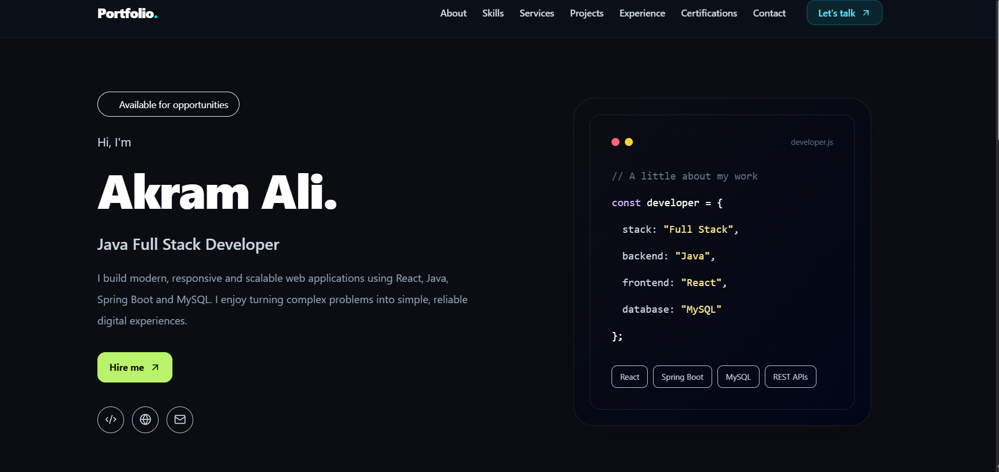

# Akram Ali — Java Full Stack Developer

A responsive full-stack developer portfolio built using React,
Tailwind CSS, Java, Spring Boot, and MySQL.

## Portfolio Preview

## About Me

I am a Java Full Stack Developer focused on building responsive
web applications, REST APIs, secure authentication, and
database-driven solutions.

## Tech Stack

- **Frontend:** React.js, JavaScript, Tailwind CSS, HTML, CSS
- **Backend:** Java, Spring Boot, Spring Security, Hibernate/JPA
- **Database:** MySQL, SQL
- **Tools:** Git, GitHub, Maven, Postman

## Featured Projects

- **E-Commerce Platform:** Product management, shopping cart,
  checkout workflows, and role-based authentication.
- **Hotel Booking System:** Room availability, reservations,
  booking cancellation, and secure access control.

## Contact

- **Email:** aliakram8355@gmail.com
- **LinkedIn:** [Connect with me](https://www.linkedin.com/in/akram-ali-b05331245/)
- **GitHub:** [View my repositories](https://github.com/akgitram)
